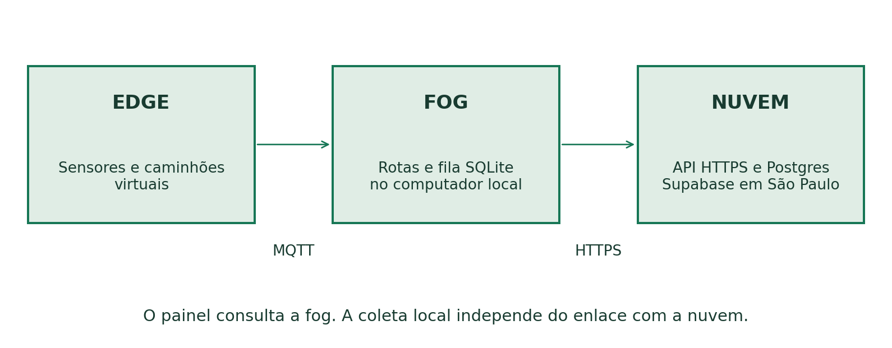

# SmartWaste DF

**Engenharia de Software - Anny, Arthur, Eduardo e Jéssica**

Laboratório de coleta inteligente com **32 lixeiras e três caminhões virtuais**. A versão pública agora inclui a implementação distribuída com MQTT real, fila persistente, catálogo de sensores e telemetria padronizada.



## Começar pelo laboratório local

Use Python 3.12. No Windows, extraia ou clone o projeto e abra **INICIAR_LOCAL.bat**. Ele instala as dependências e inicia a edge, o broker MQTT, a fog e uma nuvem emulada. O painel abre em `http://127.0.0.1:8000`.

```bat
py -3.12 -m venv .venv312
.venv312\Scripts\python -m pip install -r requirements-distributed.txt
.venv312\Scripts\python run_distributed.py
```

Linux/macOS: use `python3.12 -m venv .venv312` e `.venv312/bin/python` no lugar do caminho Windows. Internet é necessária para instalar dependências; o laboratório local funciona depois sem conexão com a nuvem. Mantenha o terminal aberto. Ctrl+C encerra os processos.

O código da versão base continua em `run_lab.py`. Ele executa outra simulação e não deve ser usado para comparar o estado do painel distribuído da mesma sessão.

## O que cada camada faz

| Camada | Responsabilidade | Comunicação |
|---|---|---|
| Edge | Simula sensores, movimento e execução de comandos | MQTT com a fog |
| Fog | Decide rotas, mantém dados e catálogo, atende ao painel | MQTT local e HTTP no próprio computador |
| Nuvem | Recebe lotes e guarda histórico | HTTPS quando hospedada |

MQTT é um protocolo de mensagens. O broker encaminha as publicações. ACK é uma confirmação; a confirmação da aplicação ocorre após persistir o dado ou aplicar o comando. QoS 1 admite repetições, por isso os IDs permanecem estáveis e o receptor remove duplicações.

O painel e os serviços locais continuam restritos a `127.0.0.1`. O broker de laboratório é anônimo e não possui TLS/ACL por sensor. Não abra essas portas na internet sem uma etapa específica de segurança.

## Atualização de 20/10/2026

| Mudança | Resultado |
|---|---|
| Contrato canônico 1.0 | Lixeiras e sensores de solo usam a mesma estrutura de telemetria. |
| Catálogo persistente | Domínios, perfis, locais, áreas e dispositivos são cadastrados por API. |
| Erros por mensagem | Dados válidos avançam; inválidos ficam em quarentena com o motivo. |
| Histórico por medição | Dados atrasados entram na posição correta, sem regredir o estado recente. |
| Limite por bytes e quantidade | O sincronizador divide lotes para respeitar o limite de transporte. |

O motor de coleta, as estratégias e o painel foram preservados. Um sensor externo pode enviar dados para a integração sem passar a controlar caminhões ou irrigação automaticamente.

## Documentação e slides

| Material | Conteúdo |
|---|---|
| [Apresentação resumida — 6 slides](docs/entrega/SmartWaste_Apresentacao_Resumida_6_Slides.pptx) | Termos técnicos explicados em cada slide; arquitetura, internet, dados, ganhos e limites |
| [Roteiro da apresentação resumida](docs/entrega/ROTEIRO_APRESENTACAO_6_SLIDES.md) | Sugestão de fala e cuidados ao explicar os resultados |
| [Guia da atualização](docs/ATUALIZACAO_PLATAFORMA_IOT.md) | Antes/depois, lógica, catálogo e teste passo a passo |
| [Estado da implementação](docs/IMPLEMENTATION_STATUS.md) | O que está pronto e o que permanece pendente |
| [Apresentação PowerPoint](docs/entrega/SmartWaste_Apresentacao_Atualizada.pptx) | Versão completa anterior, com 14 slides |
| [Apresentação PDF](docs/entrega/SmartWaste_Apresentacao_Atualizada.pdf) | PDF da versão completa anterior, com 14 slides |
| [Guia distribuído](README_DISTRIBUIDO.md) | Execução, protocolos e limitações |
| [Contratos](contracts/) | JSON Schema e AsyncAPI |
| [Evidências atuais](docs/evidence-platform/) | Saídas dos testes e ensaio integrado |
| [Relatório acadêmico anterior](docs/entrega/SmartWaste_Relatorio_Faculdade.pdf) | Registro da entrega de 19/10, anterior ao catálogo e à quarentena |
| [Versão base](README_VERSAO_BASE.md) | Documentação original da coleta e das rotas |

## Integração e análise dos dados

Acesse `http://127.0.0.1:8000/docs` para cadastrar sensores e enviar mensagens. A API aceita ingestão individual em `/api/v1/ingestao` e lotes em `/api/v1/ingestao/lote`. Um lote local pode ter até 5.000 mensagens e 8 MiB. Cada envio à nuvem respeita 100 mensagens e 256 KiB.

O histórico canônico em `/api/v1/telemetria` aceita período, dispositivo, grandeza, local, área, paginação e ordenação. `/api/v1/quarentena` mostra recusas. O botão Exportar PDF continua disponível; `/api/export` inclui o histórico legado, dados canônicos e quarentena em JSON.

A estratégia escolhe a próxima lixeira. Dijkstra calcula o caminho até ela. A estratégia Smart é uma heurística do projeto e não garante o ótimo global.

## Testes executados

**60 testes Python e 28 JavaScript aprovados.** O ensaio integrado usou processos separados e MQTT real: 32 lixeiras, três caminhões, duas leituras rurais por HTTP/MQTT e confirmação pela nuvem local. Clientes Python, JavaScript e Java também enviaram mensagens com sucesso.

O teste de lote aceitou 4.997 de 5.000 mensagens e isolou as três inválidas. Isso descreve esse teste, não uma taxa universal de confiabilidade. Os dados são sintéticos e não demonstram economia de combustível, SLA ou capacidade de produção.

```bat
.venv312\Scripts\python -m pytest tests -q
node --test supabase/functions/smartwaste-api/core.test.mjs supabase/functions/smartwaste-api/handler.test.mjs tests/distributed/ui-state.test.cjs
.venv312\Scripts\python scripts/verify_platform.py --clients
```

Feche o laboratório antes do ensaio integrado, pois ele utiliza as mesmas portas. Node e Java são opcionais e só são necessários para seus respectivos testes e exemplos.

## Supabase e dados privados

O projeto pode enviar dados por HTTPS ao Supabase, mas **o repositório não inclui credenciais**. O laboratório local não exige conta no provedor. Para sua própria hospedagem, configure um projeto e uma identidade de fog; `cloud-config.example.json` mostra apenas os nomes dos campos, sem valor utilizável. Guarde o arquivo real como `cloud-config.json` ou `SmartWaste_Conexao_Privada.json`, ambos ignorados pelo Git.

A implementação anterior das lixeiras permanece compatível com a função já hospedada. O novo endpoint canônico e o SQL em `supabase/platform-schema-proposal.sql` estão preparados, **sem implantação remota por esta publicação**. Até a atualização, novos sensores ficam pendentes localmente se a nuvem responder 404 em `/platform-ingest`.

O plano Free tem cotas e não significa uso ilimitado. Nenhuma alteração de plano, região ou cobrança foi feita nesta etapa. Não publique JSON de conexão, tokens, chaves administrativas, bancos locais ou ZIP privado.

## Limites importantes

A operação local depende do computador, broker e fog funcionando. A interrupção da internet mantém dados pendentes; ela não garante resistência a disco cheio ou falha física. A fila legada continua com limite de 100 mil itens. O teste real de 72 horas, a retenção, o dimensionamento de disco, autenticação de usuários, papéis e proteção MQTT são etapas futuras.
