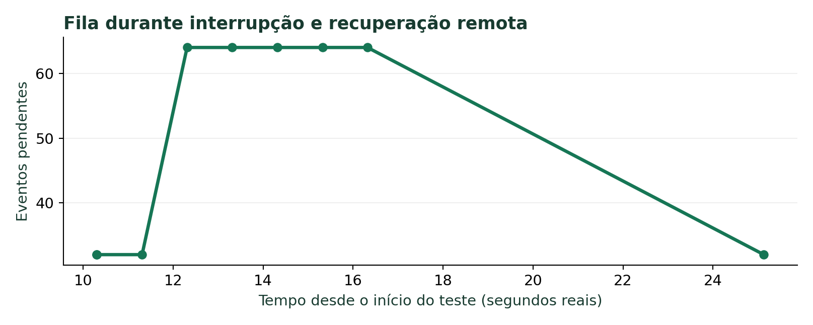
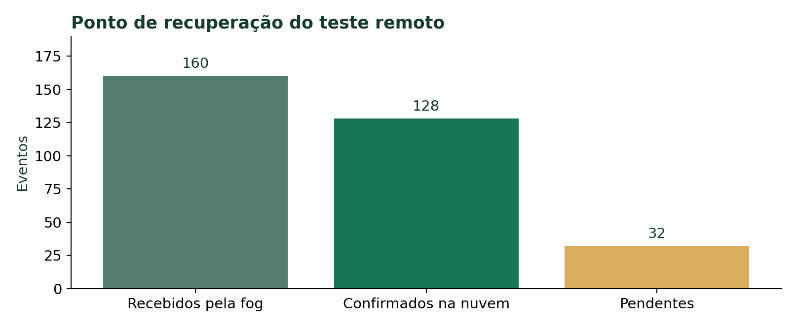

# SmartWaste DF: evolução para edge, fog e nuvem

**Engenharia de Software — Anny, Arthur e Eduardo**

**Data:** 19 de outubro de 2026

**Repositório:** https://github.com/annygabb/IoT---Coleta

Engenharia de Software
Anny, Arthur e Eduardo
19 de outubro de 2026

### Resumo

Este trabalho evolui o simulador de coleta inteligente de resíduos SmartWaste DF para uma arquitetura com edge, fog e nuvem. A edge representa 32 sensores e três caminhões virtuais. A fog coordena rotas e mantém uma fila em disco. Um broker local transporta mensagens MQTT reais entre processos. A fog envia o histórico por HTTPS para uma API hospedada no Supabase Free, na região de São Paulo. Os testes verificaram continuidade durante interrupções da nuvem, reenvio sem duplicar o histórico, confirmação de comandos e reversão de uma versão virtual com falha. A exportação em PDF permite acompanhar dados de comunicação e mudanças da operação. Os resultados se referem a um laboratório com dados sintéticos.

### Objetivo da atividade

Aplicar os conceitos de computação distribuída ao projeto do ciclo anterior, explicar por que cada responsabilidade mudou de camada e registrar evidências reproduzíveis do comportamento do sistema.

### Escopo dos artefatos

O GitHub público contém o código da versão base e a documentação desta evolução. A implementação distribuída testada integra o pacote entregue na atividade. O repositório público não contém o arquivo privado de conexão. Assim, os resultados da evolução não devem ser atribuídos ao código antigo ao executar somente o clone público.

## 1. Arquitetura e metodologia

### O papel de cada camada

A edge mede ocupação, bateria e temperatura simuladas e executa os comandos de rota. A fog recebe o estado, escolhe os próximos atendimentos e calcula os caminhos com Dijkstra. A nuvem valida e armazena o histórico em Postgres. A expressão Supabase Edge Functions é o nome de um produto: a função HTTPS desempenha o papel de nuvem neste projeto.

### Por que separar as responsabilidades

A internet deixa de fazer parte do caminho obrigatório para decidir localmente. A falha do enlace fog–nuvem não impede a comunicação MQTT local. A fila SQLite desacopla a produção das leituras da velocidade de envio. Essa separação não elimina a dependência da fog: se ela parar, novas decisões locais deixam de ocorrer.

### Procedimento

O trabalho preservou as regras do simulador original e separou a evolução física da coordenação da frota. Em seguida, acrescentou broker MQTT por TCP, identificadores, persistência e sincronização em lotes. A validação combinou testes automatizados, integração com emulador local e uma execução remota anterior com Supabase. As evidências diferenciam explicitamente esses ambientes.

O cenário tem 32 lixeiras e três caminhões. Snapshots seguem aproximadamente uma vez por segundo real. No modo remoto, 32 leituras históricas são geradas a cada cinco snapshots. A velocidade do relógio simulado altera a evolução do modelo, enquanto a cadência de comunicação depende do tempo real.

## 2. Dados e qualidade das entradas

Cada leitura precisa identificar o dispositivo, a execução e o instante a que pertence. Sem isso, uma repetição pode parecer uma nova coleta ou uma amostra atrasada pode substituir o estado atual.

| Campos | Finalidade |
| --- | --- |
| event_id / run_id | Identificar a leitura e separar reinícios da edge. |
| sequence | Preservar a ordem do estado recebido. |
| simulated_at / emitted_at | Separar o horário simulado do momento real de emissão. |
| fill_pct / battery_pct / temperature_c | Expressar ocupação, bateria e temperatura com unidades definidas. |
| operational_state / sensor_status | Distinguir criticidade da lixeira de falha do sensor. |
| firmware_version | Identificar a versão virtual que produziu a leitura. |

### Garbage in, garbage out

A expressão significa que dados de entrada incorretos podem gerar resultados incorretos. Se uma ocupação inválida for aceita, a fog pode priorizar um atendimento desnecessário. Se uma data impossível entrar no histórico, agrupamentos por dia podem ficar errados. Por isso, a API valida números finitos, faixas, estados e datas com fuso antes de confirmar o lote.

### Como encontrar datas com erro e por quê

Primeiro, verificar se o valor é uma data ISO com fuso. Isso reduz ambiguidades de formato e de horário. Depois, conferir se os componentes existem no calendário: 30 de fevereiro não é válido. Separar emissão real de horário simulado evita confundir aceleração do relógio com atraso de rede. No teste da API, uma data impossível recebeu HTTP 400. A validação estrita do contrato está na função remota; o emulador local possui validação mais simples.

### Uma leitura ilustrativa

Uma lixeira com ocupação de 95% pode exigir prioridade mesmo com sensor saudável. Já sensor_status = FAULTY identifica a falha simulada do dispositivo. Manter as duas colunas permite analisar a necessidade de coleta separadamente da confiabilidade da medição. Esse exemplo é conceitual e não uma observação de campo.

## 3. Alterações e lógica de funcionamento

| Ponto | Versão base | Evolução testada |
| --- | --- | --- |
| Comunicação | Broker em memória | MQTT real por TCP entre processos |
| Decisão | Motor reunia os papéis | Fog decide e edge executa |
| Persistência | Sem fila durável no fluxo principal | SQLite e confirmação após gravação |
| Histórico remoto | Ausente do fluxo original | Lotes HTTPS e Postgres no Supabase |
| Feedback | Aviso genérico de envio | ACK identificado e rejeição visível |
| Exportação | Visão anterior da simulação | Comunicação e comparação de ações |

### Entrega e repetição

MQTT QoS 1 admite mensagens repetidas. A edge grava snapshots antes de publicar. A fog confirma somente depois de armazenar os eventos. Em caso de ausência de confirmação, a origem reenvia com o mesmo identificador. A deduplicação impede que esse reenvio produza outra entrada no histórico. O ACK do broker é diferente do ACK de aplicação. O laboratório não garante atuação física exatamente uma vez após uma falha abrupta.

### O aviso de comando

O texto “Comando enviado. Aguardando a edge” indicava o envio, mas a mensagem geral não acompanhava o retorno. A atualização associa a interface ao command_id. Uma confirmação resolve o aviso, uma rejeição mostra o motivo e a falta de ACK após 15 segundos orienta verificar a comunicação. O relatório diferencia pedido, confirmação e estado observado.

### Clima, velocidade e rotas

A estratégia escolhe o destino e Dijkstra escolhe o caminho. Bloquear a EPTG altera as arestas disponíveis. Clima modifica fatores do modelo e também sua geração de resíduos, uma simplificação não calibrada. A velocidade acelera o relógio simulado. Portanto, aumentos de distância ou coleta entre amostras podem resultar da evolução normal e de mudanças simultâneas, não apenas de uma configuração.

## 4. Resultados de integração remota

Durante a interrupção, a fila amostrada cresceu de 32 para 64 eventos e a operação continuou avançando. Após reconectar, o sistema confirmou os eventos acumulados enquanto novas leituras chegavam. No ponto recuperado, havia 160 eventos recebidos, 128 confirmados e 32 pendentes. A fila ainda não estava vazia. Essa observação comprova recuperação naquele cenário, sem prometer ausência de perdas em qualquer falha.

## 5. Testes, canário e exportação

| Validação | Resultado e alcance |
| --- | --- |
| Python | 30 testes aprovados no pacote: 12 da base e 18 da evolução. |
| Interface JavaScript | 11 testes aprovados para apresentação dos estados. |
| Contrato da função de nuvem | 6 testes aprovados para validação dos lotes. |
| Integração local adicional | Broker real, queda/retorno, canário, ACK e PDF aprovados. |
| Integração remota anterior | MQTT local e Supabase HTTPS aprovados em uma execução. |

### Teste controlado de versão virtual

Cinco sensores formam o grupo canário e 27 permanecem como controle. A janela exige pelo menos 10 segundos, além de relatos e controles mínimos. Taxa de erro superior a 5% provoca reversão. O teste saudável manteve a versão 2.0. A campanha com falha reverteu para a versão anterior. Esse é um teste lógico: nenhuma placa física recebeu firmware.

### Exportação com evidência de mudanças

O PDF inclui métricas MQTT, bytes de payload, lotes de nuvem, status HTTP, durações e gráfico da fila. Cada ação registra o estado conhecido antes do envio, a confirmação, a primeira amostra compatível e outra amostra pelo menos 10 segundos depois. A janela real acompanha a comparação. Alterações simultâneas recebem aviso de sobreposição.

Os bytes não incluem cabeçalhos TCP ou TLS. A duração de um lote inclui a requisição e a confirmação, não um ping. Os contadores e lotes são da sessão da fog, enquanto a fila e o histórico de ações persistem. O relatório não reconstrói ações anteriores à instrumentação e não exporta todo o banco remoto.

### Como demonstrar

Iniciar o pacote distribuído, aguardar MQTT e uma confirmação da nuvem. Alterar uma condição por vez e aguardar cerca de 12 segundos depois do ACK. Desconectar a nuvem por pelo menos 15 segundos, observar a fila, reconectar e acompanhar novas confirmações. Testar as duas versões e exportar novamente. Esse roteiro ajuda a separar mudanças do ambiente da evolução normal do modelo.

## 6. Publicação, limites e conclusão

### Publicação segura no GitHub

O repositório público reúne a base do projeto e esta documentação. O arquivo de conexão da fog, tokens, chaves administrativas, bancos SQLite locais e o ZIP privado não integram a publicação. O leitor pode estudar a arquitetura e os resultados sem obter acesso ao banco do grupo. O painel continua local e a nuvem requer credencial para ingestão e consulta do histórico.

### Gratuidade e falhas possíveis

O projeto utiliza Supabase Free em São Paulo. Em 19/10/2026, a página oficial informava US$ 0 por mês, banco de até 500 MB e 5 GB de saída, com pausa após uma semana de inatividade. O uso gratuito depende das cotas. Broker, energia e internet locais usam os recursos do grupo. A retenção e o volume de leituras precisam de controle para manter o experimento dentro desses limites.

Timeout ou falha de envio mantém o lote pendente. Token inválido ou dado rejeitado exige correção. Disco indisponível impede assegurar persistência. Encerrar a fog interrompe decisões. Reiniciar a edge reinicia a física com outro run_id, sem restaurar posições anteriores. Na execução remota, quatro lotes duraram entre 6,91 e 7,82 segundos no ambiente de teste. Esses valores não comprovam latência típica do provedor nem ganho sobre a arquitetura anterior.

### Conclusão

A evolução tornou observável a separação entre medição, decisão e histórico. Os testes demonstraram que a coordenação local continuou durante a interrupção da nuvem e que os identificadores permitiram reenviar dados sem duplicar o histórico no cenário validado. A exportação acrescentou rastreabilidade às mudanças. O trabalho aplica conceitos de sistemas distribuídos com infraestrutura local e uma camada de nuvem real, mantendo sensores, frota e dados simulados.

Uma avaliação de produção exigiria hardware real, autenticação adequada da rede MQTT, restauração da física, redundância da fog e testes repetidos com cenários equivalentes. Não foram medidos ganhos reais de combustível, CO₂, custo ou desempenho em campo.

## 7. Referências e rastreabilidade

Fontes consultadas em 19 de outubro de 2026. As evidências locais pertencem ao pacote distribuído da atividade. A consulta ao GitHub identifica o código da base, não substitui os arquivos da evolução.

- [Repositório público SmartWaste DF](https://github.com/annygabb/IoT---Coleta)

- [MQTT 3.1.1 — especificação OASIS](https://docs.oasis-open.org/mqtt/mqtt/v3.1.1/os/mqtt-v3.1.1-os.html)

- [Supabase — preços e cotas](https://supabase.com/pricing)

- [Supabase — segurança e RLS](https://supabase.com/docs/guides/database/postgres/row-level-security)

- [Paho MQTT — cliente Python](https://eclipse.dev/paho/files/paho.mqtt.python/html/client.html)

### Evidências e caminhos do pacote

| Arquivo | O que permite conferir |
| --- | --- |
| docs/evidence-remote/result.json | Sucesso do fluxo remoto, ACKs e contadores recuperados. |
| docs/evidence-remote/timeline.csv | Amostras que geraram os gráficos deste relatório. |
| docs/evidence/cloud-smoke.json | HTTP 200, ausência de credencial 401, duplicação e data inválida. |
| scripts/verify_feedback.py | Integração MQTT local e exportação com ações. |
| tests/distributed/ | Comandos, estado apresentado, persistência e PDF. |
| apps/distributed/ | Implementação da edge, fog, auditoria e relatório. |

O teste remoto da API retornou 200 no health, 401 sem credencial, 200 nos dois envios do mesmo evento, uma única linha correspondente e 400 para data inválida. A verificação visual automática do dashboard em navegador e a execução nativa no Windows não foram concluídas no ambiente de testes. A revisão visual dos documentos verifica a apresentação dos resultados, não o funcionamento de dispositivos físicos.
